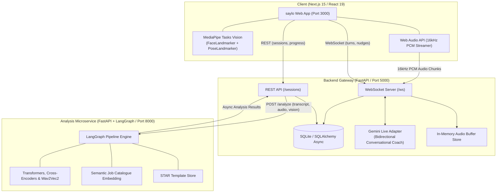
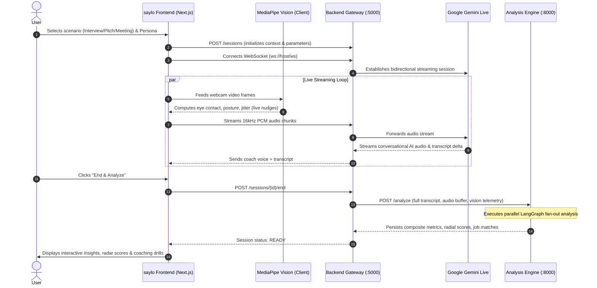
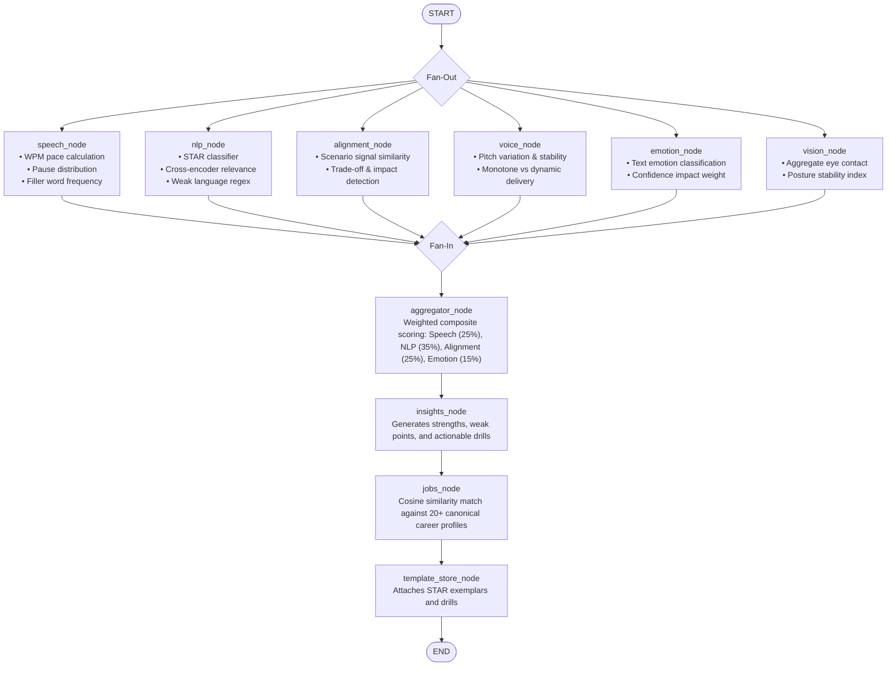

# saylo · AI Communication Coach

> **Real-time multimodal speech coaching, adaptive AI practice sessions, and deep LangGraph performance analytics.**

---

##  Table of Contents
1. [Overview](#-overview)
2. [System Architecture](#-system-architecture)
3. [End-to-End Workflow](#-end-to-end-workflow)
4. [AI & ML Models Specification](#-ai--ml-models-specification)
5. [LangGraph Analysis Pipeline](#-langgraph-analysis-pipeline)
6. [Real-Time Vision & Audio Processing](#-real-time-vision--audio-processing)
7. [Service Structure & Tech Stack](#-service-structure--tech-stack)
8. [Getting Started & Local Development](#-getting-started--local-development)
9. [API & WebSocket Protocol](#-api--websocket-protocol)

---

##  Overview

**saylo** is an intelligent communication coach designed for high-stakes conversations:
- **Adaptive Mock Interviews** (technical, behavioral, executive leadership)
- **Startup & Product Pitches** (investor probing, value proposition pressure)
- **High-Impact Meetings** (stakeholder consensus, cross-functional updates)

While you speak, saylo runs lightweight client-side computer vision models (MediaPipe GPU/WASM) for immediate posture and eye-contact cues, streams conversational turns via WebSockets to Gemini Live, and then hands off the recorded session to an asynchronous **LangGraph analytical pipeline** powered by fine-tuned transformers, audio emotion regressors, and semantic embedding spaces.

---

##  System Architecture

The project is structured into three decoupled, event-driven services:



---

##  End-to-End Workflow



---

##  AI & ML Models Specification

saylo combines state-of-the-art vision, speech, semantic, and generative models:

| Component | Architecture / Model | Source / Checkpoint | Primary Purpose |
| :--- | :--- | :--- | :--- |
| **Conversational Coach** | Multimodal LLM | `gemini-2.0-flash-exp` | Real-time adaptive questioning, follow-ups, persona roleplay, dynamic pressure |
| **In-Browser Face Mesh** | BlazeFace / FaceLandmarker | `MediaPipe FaceLandmarker Float16` | Eye contact angle, head tilt, facial orientation (runs client-side GPU/Wasm) |
| **In-Browser Body Pose** | BlazePose / PoseLandmarker | `MediaPipe PoseLandmarker Lite Float16` | Posture alignment, slouch detection, nervous swaying/movement frequency |
| **STAR Answer Classifier** | Fine-Tuned Transformer | Custom trained (`model/star_answer`) | Evaluates behavioral answer structure: Situation, Task, Action, Result |
| **Contextual Relevance** | Cross-Encoder | `cross-encoder/ms-marco-MiniLM-L-6-v2` | Deep cross-attention score between user answers and role requirements |
| **Semantic Embeddings** | Sentence Transformer | `sentence-transformers/all-MiniLM-L6-v2` | Signal matching, question-answer alignment, semantic job profile matching |
| **Vocal Affect & Emotion** | Wav2Vec2 + Custom MLP Head | `audeering/wav2vec2-large-robust-12-ft-emotion-msp-dim` | Continuous 3D emotion dimensions: Arousal (energy), Valence, Dominance (assertiveness) |
| **Textual Emotion** | DistilRoBERTa Classifier | `j-hartmann/emotion-english-distilroberta-base` | Detects confidence-impacting emotions: joy, fear, sadness, anger, surprise |
| **Acoustic Signal Metrics** | DSP & Librosa Pipeline | Librosa / SciPy | Pitch variation (F0), speaking rate (WPM), pause durations, vocal jitter |

---

##  LangGraph Analysis Pipeline

When a session concludes, the Analysis Microservice invokes an asynchronous **StateGraph** built on LangGraph. Parallel nodes execute simultaneously, fan-in to an aggregator, and then pass through a sequential refinement chain:



### Analysis Pipeline Output
- **Overall Confidence Score**: Weighted composite index normalized to `0.0 - 1.0`.
- **Speech Delivery**: Rate of speech (ideal: 130–160 WPM), filler word ratio, pause intervals.
- **Language & Structure**: STAR compliance score, weak language penalty (e.g., "sort of", "kind of", "basically").
- **Semantic Alignment**: Scenario-specific signal recognition (e.g., Problem-Solution-Traction for Pitches; STAR-Impact for Interviews).
- **Personalized Job Recommendations**: Replaces naive heuristics with genuine embedding cosine distance between user speech transcripts and job requirements, complete with verified LinkedIn search URLs.

---

##  Real-Time Vision & Audio Processing

```
User Webcam & Mic
  │
  ├─► [Client-Side MediaPipe Vision]
  │     ├── FaceLandmarker (GPU/WASM)  ──► Eye contact calculation (distance vector to camera)
  │     └── PoseLandmarker (GPU/WASM)  ──► Shoulder slope & center-of-mass jitter tracking
  │           └─► Real-Time Cues in UI:
  │                 • "Keep your gaze on the camera"
  │                 • "Shoulders aligned — good posture"
  │                 • "Slightly too much movement, steady yourself"
  │
  └─► [Web Audio API Worklet]
        ├── 16kHz Mono Float32 Audio Buffer
        ├── Downsampled to 16-bit PCM chunks
        └── Streamed over WebSocket to Backend ──► Forwards to Gemini Live
```

---

##  Service Structure & Tech Stack

```
/saylo
├── frontend/                     # Next.js 15 + React 19 Frontend
│   ├── app/
│   │   ├── page.tsx              # Full-viewport welcome landing hero
│   │   ├── dashboard/page.tsx    # Dedicated performance analytics dashboard
│   │   ├── session/page.tsx      # Real-time multimodal practice arena
│   │   ├── insights/page.tsx     # In-depth post-session evaluation & recommendations
│   │   ├── history/page.tsx      # Filterable session archive
│   │   ├── roadmap/page.tsx      # Goal progress, milestone tracking & drills
│   │   ├── speech/page.tsx       # Targeted speech exercise drills
│   │   ├── layout.tsx            # Navigation header, logo branding & global layout
│   │   └── globals.css           # Vanilla CSS Clear Horizon Design System
│   ├── components/               # NavActive, DashboardView, HistoryClient
│   └── hooks/                    # useVisionMetrics (MediaPipe GPU runtime)
│
├── backend/                      # FastAPI Backend Gateway (:5000)
│   ├── api/                      # REST endpoints (/sessions) & WebSocket (/ws)
│   ├── db.py                     # SQLAlchemy async SQLite engine
│   ├── models/schemas.py         # DB models: Session, TranscriptSegment, SessionAnalysis
│   ├── services/                 # Gemini Live client, scenario prompts, context builders
│   └── utils/                    # Audio buffer store, cuid generator, structured logger
│
└── services/analysis-service/    # LangGraph AI Analytics Microservice (:8000)
    ├── app.py                    # FastAPI entrypoint (/analyze)
    ├── graph/
    │   ├── analysis_graph.py     # StateGraph definition (fan-out / fan-in)
    │   ├── nodes.py              # Parallel analysis node implementations
    │   └── state.py              # Strongly-typed AnalysisState
    └── modules/                  # Specialized scoring engines:
        ├── speech.py             # WPM, pause detection, filler words
        ├── nlp.py                # STAR classifier & cross-encoders
        ├── voice_emotion.py      # Wav2Vec2 arousal/valence/dominance
        ├── emotion.py            # DistilRoBERTa text emotion
        ├── alignment.py          # Semantic signal embedding similarity
        └── job_match.py          # Embedding-based career match catalogue
```

---

##  Getting Started & Local Development

### Prerequisites
- **Node.js** (v18.17+ or v20+)
- **Python** (v3.10+ or v3.11)
- **Google Gemini API Key** ([Google AI Studio](https://aistudio.google.com/))

### 1. Clone the Repository
```bash
git clone https://github.com/jiyajain23/speakEz-JJ.git
cd speakEz-JJ
```

### 2. Configure Environment Variables
Create `.env` in `backend/`:
```env
PORT=5000
DATABASE_URL=sqlite+aiosqlite:///./dev.db
ALLOWED_ORIGINS=http://localhost:3000
GEMINI_API_KEY=your_gemini_api_key_here
ANALYSIS_SERVICE_URL=http://localhost:8000
```

Create `.env.local` in `frontend/`:
```env
NEXT_PUBLIC_API_BASE=http://localhost:5000
NEXT_PUBLIC_WS_BASE=ws://localhost:5000/ws
```

---

### 3. Launch Services (Three Terminals)

#### Terminal 1 — Analysis Microservice
```bash
cd services/analysis-service
python -m venv venv
# On Windows: venv\Scripts\activate | On macOS/Linux: source venv/bin/activate
pip install -r requirements.txt
uvicorn app:app --host 0.0.0.0 --port 8000 --reload
```

#### Terminal 2 — Backend Gateway
```bash
cd backend
python -m venv venv
# On Windows: venv\Scripts\activate | On macOS/Linux: source venv/bin/activate
pip install -r requirements.txt

# Initialize database tables:
python -c "import asyncio; from db import init_db; asyncio.run(init_db())"

uvicorn main:app --host 0.0.0.0 --port 5000 --reload
```

#### Terminal 3 — Frontend Web Application
```bash
cd frontend
npm install
npm run dev
```

---

##  API & WebSocket Protocol

### REST Endpoints (Backend Gateway `:5000`)
| Method | Route | Description |
| :--- | :--- | :--- |
| `POST` | `/sessions` | Create a new session with scenario, persona, and background text |
| `GET` | `/sessions` | List all historical sessions with pagination |
| `GET` | `/sessions/{id}` | Retrieve session details, transcript, and full analysis results |
| `POST` | `/sessions/{id}/end` | Conclude session and trigger asynchronous LangGraph analysis |
| `GET` | `/sessions/progress` | Aggregate statistics: streaks, confidence trends, repeated issues |

### WebSocket Protocol (`ws://localhost:5000/ws`)
- **Client to Server:**
  - `hello`: Session handshake with `sessionId`.
  - `user_text`: Typed response from user.
  - `audio_chunk`: Binary 16kHz PCM audio payload.
  - `audio_end`: Signals end of user utterance.
  - `video_frame`: Telemetry coordinates (eye contact, posture).
- **Server to Client:**
  - `ready`: Session initialization acknowledged.
  - `ai_text`: Streaming transcript chunk from Gemini.
  - `ai_audio`: Base64 encoded audio synthesized for playback.
  - `nudge`: Real-time coaching cue.

---

